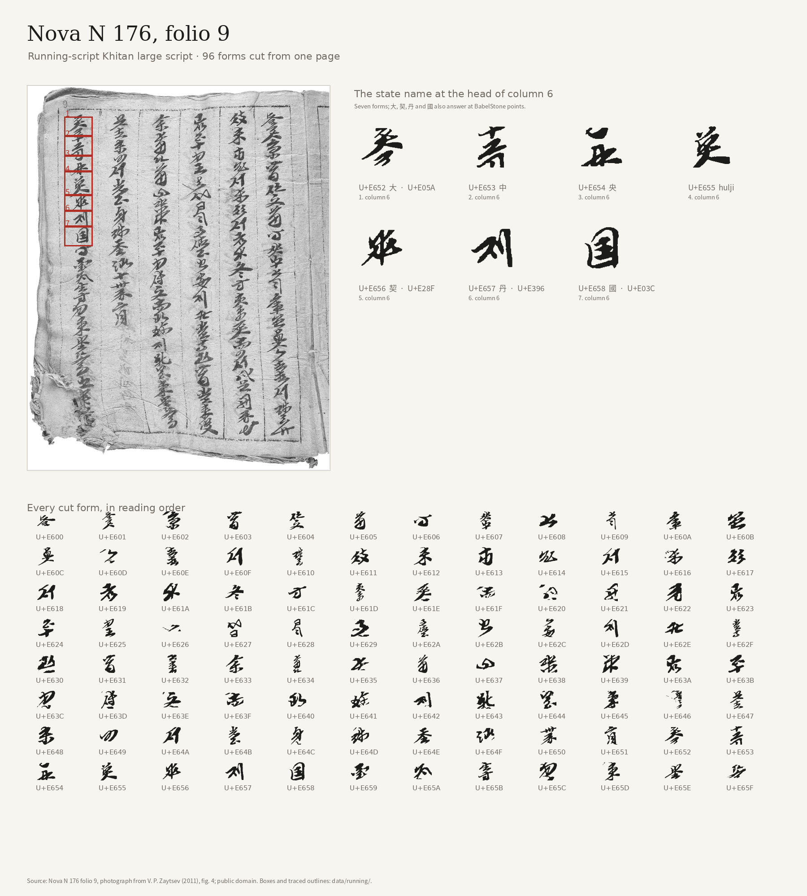

# Running-script Khitan large script from Nova N 176

96 character forms cut from folio 9 of **Nova N 176**, the Khitan large-script manuscript held at
the Institute of Oriental Manuscripts, Russian Academy of Sciences (Nova N 176, inv. 1055). The
photograph is Zaytsev's fig. 4, public domain on Wikimedia Commons:
<https://commons.wikimedia.org/wiki/File:Nova_N_176_folio_9.jpg>.

The manuscript is undeciphered and has no transcription, so the face reproduces the hand of this
page. Its code points are local to the page. The page holds more characters than the 96 cut here;
boxes that held blank paper or a rule line were left out.

## Record

`forms.json.gz` holds one record per form:

| field | meaning |
| --- | --- |
| `pua` | page-local code point, U+E600–U+E65F in reading order: columns right to left, top to bottom |
| `col` | the ruled column, 1 on the right to 6 on the left |
| `box` | the cut on the photograph, `[x, y, width, height]` in pixels |
| `aliases` | BabelStone Private Use points, for the four forms Zaytsev identifies |
| `identification` | the word of the state name, for the seven forms at the head of column 6 |
| `identification_basis` | the table the identification comes from |
| `manual` | whether the box was set by hand |
| `ink`, `mask_pixels` | how much of the box is ink, and the traced mask's pixel count |
| `outline` | `M`, `L`, `C` and `Z` commands in font units |

The outlines use a 1000-unit em, a baseline at 0, and an ink box 880 units on its longest side
centred at (500, 372).

## The state name

The seven forms at the head of column 6 are the state name **大中央□契丹國**, as Zaytsev reads it:

| form | word | BabelStone |
| --- | --- | --- |
| U+E652 | 大 | U+E05A |
| U+E653 | 中 | — |
| U+E654 | 央 | — |
| U+E655 | hulʤi | — |
| U+E656 | 契 | U+E28F |
| U+E657 | 丹 | U+E396 |
| U+E658 | 國 | U+E03C |

The cursive forms follow the order of the table's left column; the identifications follow Zaytsev. See V. P. Zaytsev, [“A Manuscript Codex Written in the Khitan Large Script from
the Collection of the Institute of Oriental Manuscripts, Russian Academy of Sciences”](http://www.orientalstudies.ru/rus/images/pdf/PPV_2011_2-15_10_zaitsev.pdf)
(2011), pp. 135, 143–145, Tables 4–5.

## Cutting

The initial boxes came from Glyph Atlas's class-agnostic character detector
(`glyph_atlas.detect`, an RT-DETR ONNX model) run on the page. The seven state-name boxes were then
set by hand, boxes that held a rule line or a neighbour's stroke were dropped, and boxes on blank
paper at the foot of the columns were removed. `cuts.json` is the reviewed result, so a rebuild
needs neither the model nor a GPU.

`scripts/build_running_forms.py` re-cuts each box, flattens the paper tone, separates ink with an
Otsu threshold, drops components at the box edges, traces the mask with potrace, and fits it to the
em. `scripts/build_running_font.py` writes the TTF and WOFF2. Some boxes cut a stroke at the edge or
keep a fleck of a neighbour; the font reproduces what the cut holds and does not redraw it.

## Licence

The photograph is PD-scan (PD-old-100) on Wikimedia Commons. The traced outlines derive from it and
are offered under the same public-domain terms. The scripts follow the repository's MIT licence.

## Rebuilding

```sh
uv run scripts/build_running_forms.py
uv run scripts/build_running_font.py
uv run scripts/build_running_specimen.py
```

The specimen needs Noto Sans CJK for the Chinese labels; the forms builder writes the cached
photograph the specimen reads.


